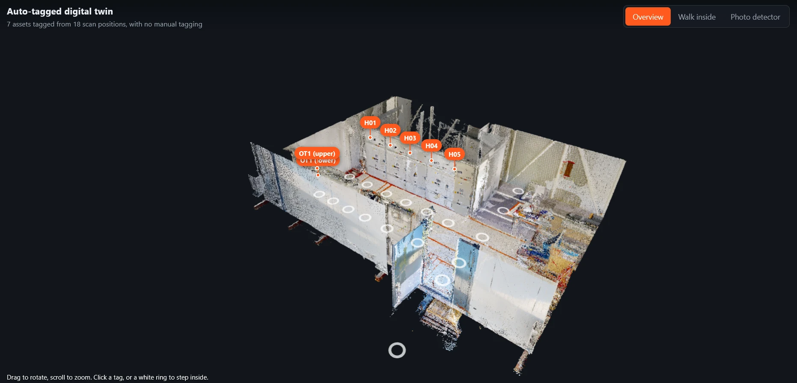
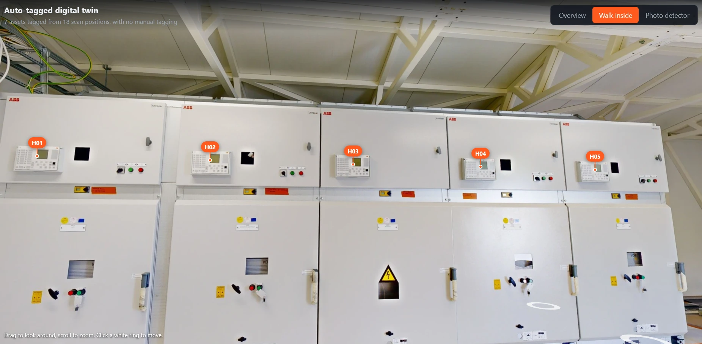
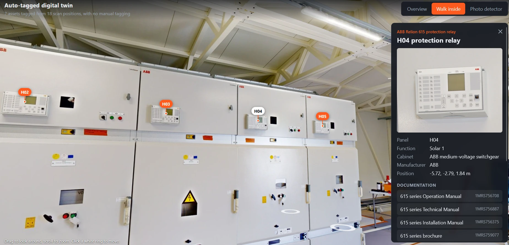
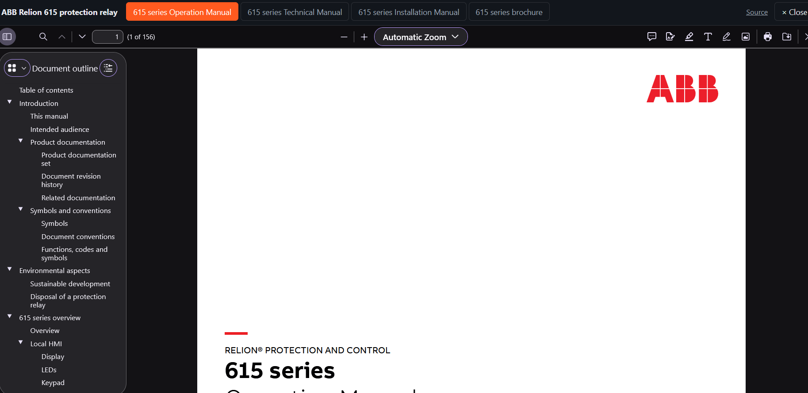
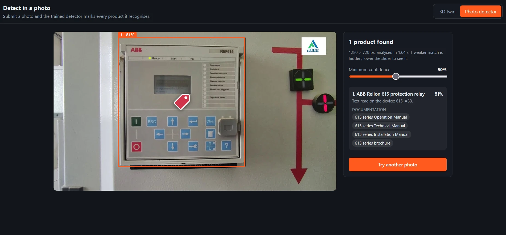

# Automatic product tagging in a digital twin: website

**Live demo:** https://sayma-code.github.io/Vaasa-hackathon-frontend/

A 3D digital twin of a scanned switchgear room in which every ABB Relion 615 relay was found and
tagged automatically. Clicking a tag opens the asset's details and documentation.

## What the live demo shows

**Overview**: the room as a coloured point cloud, with a tag on each of the 7 relays. White rings mark
the positions the scanner stood at.



**Walk inside**: the scan photos as a look-around panorama, with the tags pinned to the relays.
Click a white ring on the floor to move to another position.



**Tags**: click one to see the relay's name, panel, function, close-up photo and position, and the
links to its documentation.



**Documentation**: a document opens inside the page, with buttons to switch between the four ABB documents.



## Photo detector: shown as a video

The project also has a photo detector: you submit a photo and the trained detector marks every relay
in it and links its documentation.

It is not on the live demo. Detection runs in a program that needs a computer with a graphics card (GPU),
and the live site is hosted on GitHub Pages, which only serves files and cannot run that program.
It is shown in this video instead:

**Video:** VIDEO-LINK-HERE

The page itself is in this repository (`detect.html`) and works in the local demo described below.



## Where the tags come from

The tags and everything in `data/` are produced by the algorithm in the separate backend repository:
https://github.com/sayma-code/Vaasa-hackathon-backend

## One site, two ways to run it

The site checks whether the backend's demo server is reachable and adapts:

| | Live demo (GitHub Pages) | Local demo with the backend server |
|---|---|---|
| Overview and walk inside | Yes | Yes |
| Documentation | Shown from ABB's library | Shown from the server's local copies, works offline |
| Photo detector | Not available, see the video | Available |

## Running it locally

As a static site, from this folder:

```
python -m http.server 8766
```

Then open http://localhost:8766. For the full demo with the photo detector, place the backend
repository beside this folder and run its `start_demo.bat`.

## Files

| Path | Content |
|---|---|
| `index.html`, `app.js` | The 3D twin and walk-inside view |
| `detect.html`, `detect.js` | The photo detector page |
| `docviewer.js` | The in-page document viewer |
| `data/` | Point cloud, scan photos, tags and asset close-ups, built by the backend |
| `lib/` | three.js |
| `screenshots/` | The pictures used in this README |

## Sources

- Scan: provided by the hackathon organisers.
- Documentation: public ABB 615 series documents.
- 3D rendering: three.js.
